# Product spec (from plan.md)

Canonical product behaviour for frontend and API. Source: [`../plan.md`](../plan.md).

## Scope

- **In:** Skilled Worker, ILR (SET(O)).
- **Out (MVP):** supervisor role, UK GDPR/compliance program, audit logs, OneDrive/SharePoint API, other visa routes.

**Reference samples:**

| Route | Folder |
|--------|--------|
| Skilled Worker (dependant) | `Resources/Skilled worker dino dominic/` |
| ILR | `Resources/ILR sophy/` |

---

## §1 Problem, goals, constraints

**Problem:** Manual checklist → email list → misnamed / unexplained client files → manual rename into OneDrive-style folders.

| Who | MVP outcome |
|-----|-------------|
| Staff | Checklist PDF → confirm case → share link → download **one zip** |
| Client | Fixed slots → **all mandatory** → **save for later** → **Finish** |

**Constraints:**

| Rule | Detail |
|------|--------|
| Checklist input | **PDF only** (UKVI) |
| Client file size | **≤ 7 MB per file** — clear error if exceeded |
| Slots | **All mandatory** before Finish (MVP) |
| Persistence | Progress on **server** (P2+); same client link |
| Compliance | **No audit log** in MVP |
| Delivery | Caseworker **zip download** only (OneDrive later) |

---

## §2 Users

1. **Staff** — password login (shared firm account OK for MVP).
2. **Client** — **no account**; **secret link** (long random token).

No supervisor.

---

## §3 End-to-end flow

```mermaid
flowchart LR
  A[Staff uploads checklist PDF] --> B[Extract UAN name route hints]
  B --> C[Load route template + map checklist lines]
  C --> D[Staff review adjust add slots]
  D --> E[Publish client link]
  E --> F[Client uploads each slot]
  F --> G[Auto-save progress]
  G --> H[Finish when all slots filled]
  H --> I[Build zip + cover letter]
  I --> J[Staff downloads zip]
```

### Staff (UI must support)

1. New case → upload checklist PDF.
2. Parse → editable: UAN, full name, product/service → route, checklist bullets for extra slots.
3. Review → fix first names / dependant names; **add** slots (rare); MVP: prefer add over remove; all client slots stay mandatory.
4. Publish → copy URL.
5. Client finishes → download zip; case status on dashboard.

### Client (UI must support)

1. Hub: applicant name, **general guidance**, numbered list.
2. Per slot: do/don’t, **sample**, upload ≤ 7 MB.
3. Save and return later.
4. Finish when every slot has a file.
5. Thank you; staff notified **manually** in MVP OR status on staff dashboard (**no email required**).

---

## §4 Checklist PDF parsing

- **Library:** `pdf-parse` or `pypdf` — **no cloud OCR** (MVP).
- **Staff must confirm** on review before publish — parse assists only.

| Field | Pattern / anchor |
|--------|------------------|
| UAN | `Unique Application Number:\s*(\d{4}-\d{4}-\d{4}-\d{4})` |
| Full name | `Applicant's full name:\s*(.+)` |
| Route hint | `Product name/service:\s*(.+)` |
| Submitted date | `Submitted date:\s*(.+)` |

**Route detection:**

| Product/service contains… | Template |
|---------------------------|----------|
| `Set (O)` / `SET(O)` | `ilr` |
| Skilled worker / PBS dependant / partner | `skilled_worker` |
| Unclear | Staff picks route on review |

**Checklist lines:** Split after `Mandatory documents` / `Other documents`; **keyword map** (consent → consent slot, payslip → payslip, etc.). Unmatched → staff adds slot.

**FE:** Show parsed fields on review; manual override; low-confidence banner.

Original checklist PDF → zip **Misc** (§7).

---

## §5 Requirements engine

Merge **in order:**

1. **Route template** — fixed slot list (§7 / `SLOT-TEMPLATES.md`).
2. **Checklist PDF** — may add slots (more common on ILR).
3. **Staff additions** — edge cases.

**Office standards (always apply):** consent, e-visa, share code (per person), BRP where applicable, **cover letter generated** (not client upload), SW dependant pack (partner passport, marriage, CoS, etc.).

HO may only list passport; **template drives client list.**

---

## §7 Zip behaviour (summary)

See [`SLOT-TEMPLATES.md`](SLOT-TEMPLATES.md) for full trees and naming.

On **Finish**, server:

1. Renames uploads to slot `targetFileName`.
2. Inserts generated cover letter at correct number.
3. Copies checklist to **Misc**.
4. Zips for download.

Top-level folder name: e.g. `{ApplicantLastName}_{UAN}_Documents/` or `{LastName} {FirstName} {date} Checklist` — **configurable on case** (staff setting in UI).

---

## §8 Cover letter generation

**Templates:**

- `Resources/Skilled worker dino dominic/Skilled worker cover letter template.docx`
- `Resources/ILR sophy/covering letter template ilr.docx`

**Approach:** `docxtemplater` (Node) or `python-docx`.

| Placeholder | Source |
|-------------|--------|
| UAN | Checklist |
| Title + full name | Parse + staff edit |
| Date | Submitted date or today |
| SW partner/sponsor | Staff (dependant cases) |

**ILR:** Long narrative — MVP **A:** auto UAN/name/title/date only; **B:** full docx string replace.

**Output names:** `3 Cover Letter.docx` (SW) or `9 Cover Letter` (ILR). Client does **not** upload these slots.

---

## §10 Technical architecture (MVP)

| Piece | Suggestion |
|-------|------------|
| App | Next.js (API + UI) or Express + HTML |
| DB | SQLite |
| Files | Local disk `storage/cases/{id}/` |
| Staff auth | Session cookie + bcrypt |
| Client auth | Token in URL (UUID) |
| PDF | pdf-parse / pypdf |
| Zip | archiver / zipfile |
| Cover letter | docxtemplater + repo docx |

No S3/Azure/email v1. Optional: Railway/Fly + persistent volume.

### Data model (FE types must match)

- **Case** — uan, route, applicantFullName, firstName, title, partnerFirstName?, status, staffNotes
- **Slot** — caseId, sortNumber, documentName, personFirstName?, required, targetFileName, clientUploaded?, instructions, donts[], sampleAsset?, clientDownloadAsset?
- **Upload** — slotId, originalName, storedPath, sizeBytes, uploadedAt
- **ClientToken** — caseId, token, expiresAt? (optional)

---

## §11 Validation

| Target | Rule |
|--------|------|
| Staff checklist upload | PDF only; max ~**15 MB** |
| Client upload | ≤ **7 MB** per file (size only; any file type) |
| Soft checks | Warnings on e-Visa / Share Code (§6.3); staff/client can still proceed in MVP |
| Finish | One file per slot (CoS pending: text file allowed per firm rule) |
| After Finish | **Client locked**; staff downloads zip; **reopen client** = v2 |

**Filename sanitize:** Remove `\ / : * ? " < > |`.

---

## §13 Open choices (MVP defaults)

| Question | Default |
|----------|---------|
| 7 MB | **Per file** |
| Link expiry | None or 90 days; staff can regenerate token |
| Files per slot | **One** |
| Cover letter | Generated; client does not upload slot 3/9 |
| Staff auth | Shared login OK v1 |

**FE:** Token regeneration UI (P3/P4); expiry optional config.

---

## §14 Developer resource checklist

Copy into app repo:

- `templates/skilled-worker.docx`, `templates/ilr.docx`
- `config/skilled-worker-slots.json`, `config/ilr-slots.json`, `config/checklist-keywords.json`
- `config/instructions/general.md`, `config/instructions/per-slot/*`
- `Resources/samples/*`
- `templates/home-office-consent-blank.pdf`

**Golden tests:** Resources PDFs → UAN + name parse; zip filenames match `{n} {name} {firstName}`.

---

## §15 Summary

Checklist PDF in → route templates + staff tweaks → client link with mandatory numbered slots, instructions, save for later → zip with **Documents/** + **Misc/**, cover letter from docx, 7 MB per file, two routes only.
