# UK Immigration Document Portal — MVP Plan

Centralized tool for **staff** to turn a Home Office **checklist PDF** into a **client upload link**, then receive a **zip** whose files match your firm’s **numbered naming convention** (document number + document name + person’s first name).

**Scope now:** **Skilled Worker** and **ILR (SET(O))** only.  
**Out of scope for MVP:** supervisor role, UK GDPR/compliance program, audit logs, OneDrive/SharePoint API, other visa routes.

Reference samples live in `Resources/` (and duplicates at repo root):

| Route | Folder |
|--------|--------|
| Skilled Worker (dependant example) | `Resources/Skilled worker dino dominic/` |
| ILR | `Resources/ILR sophy/` |

---

## 1. Problem and goals

**Today:** Manual checklist review → email a document list → clients send wrongly named or unexplained files → staff renames and sorts into OneDrive-style folders.

**MVP success:**

| Who | Outcome |
|-----|---------|
| **Staff (caseworker)** | Upload checklist PDF → confirm case details → get shareable link → download **one zip** ready to drop into your usual folder workflow |
| **Client** | Open link → upload **every** required item into fixed slots → **save and continue later** → **Finish** when complete |

**Constraints (MVP):**

- Checklist input is **always PDF** (UKVI document checklist).
- **7 MB maximum per uploaded file** (reject larger uploads with a clear message).
- **All slots mandatory** for the client before **Finish** (no optional uploads in MVP).
- **Draft / save for later:** uploads and progress persist on the server; same link works when the client returns.
- **No audit log** or formal compliance features in MVP.
- **Delivery:** caseworker downloads **zip** only (OneDrive integration later).

---

## 2. Users

1. **Staff** — simple password login (single firm / shared staff account is fine for MVP).
2. **Client** — **no account**; access via **secret link** (long random token in URL).

No supervisor role.

---

## 3. End-to-end flow

```mermaid
flowchart LR
  A[Staff uploads checklist PDF] --> B[Extract UAN name route hints]
  B --> C[Load route template + map checklist lines]
  C --> D[Staff review adjust add slots]
  D --> E[Publish client link]
  E --> F[Client uploads each slot]
  F --> G[Auto-save progress]
  G --> H[Finish when all slots filled]
  H --> I[Build zip + cover letter]
  I --> J[Staff downloads zip]
```



### Staff steps

1. **New case** → upload checklist PDF.
2. **Parse** (automatic, then editable):
   - **UAN** — e.g. `Unique Application Number: 1212-0001-6466-5462`
   - **Applicant full name** — e.g. `Mrs SOPHY BIJUMON` / `Mr Dino Dominic`
   - **Product / service** — e.g. `Set (O)` → **ILR**; dependant skilled worker phrases → **Skilled Worker**
   - **Checklist bullets** (mandatory + other documents) for optional extra slots when wording differs
3. **Review screen** — show merged upload slots (see §5). Staff can:
   - Fix first names / dependant names
   - **Add** extra slots (rare) with next number or manual number
   - Remove slots only if you later allow exceptions (MVP: prefer “add” over remove; all client slots stay mandatory)
4. **Publish** → copy client URL.
5. When client finishes → **Download zip** (and reopen case to see status).

### Client steps

1. Open link → see applicant name, **general upload guidance**, and list of required documents (numbered, plain English).
2. For **each slot**: read **do / don’t** instructions, view **sample file** (how a good upload looks), then upload; **max 7 MB** each.
3. Leave and return anytime — **progress saved**.
4. **Finish** — enabled only when **every** slot has a file.
5. Thank-you screen; staff notified manually (no email required in MVP) or simple “submitted” status on staff dashboard.

---

## 4. Checklist PDF parsing (simple, effective)

**Library:** `pdf-parse` or `pypdf` in Node/Python — no cloud OCR for MVP.

**Reliable fields (regex on extracted text):**

| Field | Pattern / anchor |
|--------|------------------|
| UAN | `Unique Application Number:\s*(\d{4}-\d{4}-\d{4}-\d{4})` |
| Full name | `Applicant's full name:\s*(.+)` |
| Route hint | `Product name/service:\s*(.+)` |
| Submitted date | `Submitted date:\s*(.+)` |

**Route detection (MVP rules):**

| If product/service contains… | Template |
|------------------------------|----------|
| `Set (O)` / `SET(O)` | `ilr` |
| Skilled worker / PBS dependant / partner (as in Dino sample) | `skilled_worker` |
| Unclear | Staff **must** pick Skilled Worker or ILR on review screen |

**Checklist lines:** Split text after `Mandatory documents` / `Other documents`; use a **keyword map** (e.g. “consent” → Home Office consent slot, “payslip” → payslip slot). Anything unmatched → staff adds slot manually.

**Always store** the original checklist PDF inside the zip **Misc** area (see §7).

**Staff confirmation is required** before publish — parsing assists, does not auto-send to client without review.

---

## 5. Requirements engine (Home Office + office standards)

Three layers merged **in this order**:

1. **Route template** — fixed slot list and numbering for Skilled Worker or ILR (your “final outcome” trees).
2. **Checklist PDF** — may add slots when bullets are not in the template (uncommon for these two routes).
3. **Staff additions** — extra numbered slots for edge cases.

### Office standards (always on top of HO checklist)

Regardless of how short the HO checklist is, your templates already include firm requests, for example:

- Home Office **consent**
- **E-visa** and **share code** (per person on the case)
- **BRP** where applicable
- **Cover letter** (generated from template, not uploaded by client — see §8)
- Skilled Worker dependant pack: sponsor/partner passport, marriage certificate, CoS, etc. (see Dino sample)

The HO PDF might only list “passport”; the **template** still drives the full client upload list.

---

## 6. Client instructions, samples, and staff guidance

Clients currently get quality wrong (glare, cropped passports, wrong Share Code option). The portal must surface **your curated wording** — not generic placeholders.

### 6.1 What the client sees (every case)

1. **General instructions** — shown at the top of the upload hub and optionally in a “Before you start” panel.
2. **Per-document instructions** — on each upload slot: what to provide, what **not** to do, and a **sample** (image or PDF thumbnail).

**UI pattern (MVP):** numbered slot row → expand **Instructions** → optional **See example** opens sample in a new tab / lightbox.

### 6.2 General instructions (client-facing — firm standard)

Use this text (or equivalent) on every client link:

> Please provide all the documents listed for your application.
>
> When sending your documents, please ensure that:
>
> - The images are **clear and glare-free**.
> - **All four edges** of each document are visible.
> - The documents are placed on a **plain background**.
> - All text, photos, and other details are **clearly visible and readable**.
> - The images are not blurred, cropped, or covered.
>
> **Additional documents required (not always on the Home Office checklist):**
>
> 1. **eVisa** — A screenshot is sufficient. Ensure the **visa start date** and **visa expiry date** are clearly visible.
> 2. **Share Code** — Generate the share code by selecting **“To prove an immigration matter”** (not “right to rent” or “right to work”). In GOV.UK wording this is the option to **prove immigration status** for something else.
> 3. **BRP** (if applicable)
>
> If you have any questions, please let us know. Thank you.

**Passport quality (repeat on passport slots):** all four corners visible, no shadow, no glare, every word readable.

**Closing line for staff communications (optional on Finish screen):**  
Make sure all documents meet the requirements of this list **and** the Home Office checklist provided to you.

### 6.3 Per-slot instruction content (config-driven)

Store in `config/instructions/` (or fields on each slot in `*-slots.json`):

| Field | Purpose |
|--------|---------|
| `instructions` | What to upload / how to obtain it |
| `donts` | Common mistakes (bullets) |
| `sampleFile` | Path to example image/PDF in `Resources/samples/` |
| `attachmentForClient` | Optional PDF to download (e.g. blank Home Office consent) |

**MVP slots that need strong per-document copy** (from your practice):

| Slot type | Client must know |
|-----------|------------------|
| **Share Code** | Choose **“To prove an immigration matter”** / prove immigration status — **not** right to rent or right to work. Code should show **at least 1 month** validity; prefer a **new** code. If they cannot generate a valid code, note on case — Share Code may not be required (staff decision). |
| **e-Visa** | Screenshot OK; **start and end dates** must be visible. **Reject** uploads where dates are missing — they do not prove leave validity. |
| **BRP** | Only if applicable; same photo quality rules as passport. |
| **Home Office consent (Skilled Worker)** | Use this client text on the consent slot (plus downloadable blank form): *Please complete and sign the **first page** of the attached document. Kindly ensure that all required fields are completed, including your **full name, address, postcode, date, and signature**. Once completed, upload the signed document here with your other documents.* |
| **Passport** | Four edges, plain background, no glare; every word readable. |
| **CoS (pending)** | If CoS not yet issued, employer letter confirming CoS issuance may be needed (see staff rules §6.4). |

Add ILR-specific lines on absence letter, travel ticket, payslip/bank (dates, one calendar month rule as per HO checklist) as short bullets per slot.

### 6.4 Staff-only guidance (senior document rules)

Show on **staff review / case detail** — not on the default client UI unless staff **adds slots** or toggles “show extra guidance”. MVP: staff reference panel or collapsible “Internal notes”. These cases go beyond Skilled Worker / ILR MVP but inform **when to add slots** later:

- **Pending CoS:** Ask for employer letter confirming applicant’s CoS issuance if CoS document unavailable.
- **Prove relationship:** Request chats, calls, emails, photos — **dated**, as old as possible, showing length and continuity.
- **Living together:** Prefer two document types covering **2 years** (e.g. tenancy + council tax); if not possible, maximum available (bank, utilities, bills).
- **First-time 6135/36 (switch):** Bank statements and payslips for **3 months before CoS issue date** (check CoS issue date on CoS).
- **Skilled Worker maintenance:** Maintenance must be ticked on CoS for all applicants (including dependants). If not ticked, all must have lived in UK **> 1 year**, else bank statements showing required funds.
- **NMC registration:** Request NMC certificate (doctors, nurses, etc.).
- **ILR / naturalisation:** English language (if required) and **Life in the UK** test certificate when applicable.
- **Outside UK:** TB certificate where required; PCC for health/care/education route (main or dependant).
- **e-Visa / Share Code:** Same validity rules as §6.3; passports and all scans must meet checklist quality.

Staff use this list when adding optional slots on the review screen; client-facing text for those slots should be written when the slot is added.

### 6.5 Implementation notes

- **Samples:** Add redacted good examples under `Resources/samples/` (e.g. `sharecode-correct.png`, `passport-four-edges.jpg`). Link from slot config.
- **Consent form:** Ship Skilled Worker HO consent blank PDF with the consent slot; ILR uses same consent pattern where applicable.
- **Do not rely on clients reading email** — instructions live **in the upload UI** next to each file.
- **Phase 1:** General instructions + text for Share Code, e-Visa, passport, HO consent. **Phase 2:** samples for all default slots + staff internal panel.

---

## 7. Final outcome: folders, file naming, zip layout

Studied from your sample screenshots (`Skilled worker documents.png`, `Skilled worker misc.png`, `documents structure ilr sophy.png`).

### Naming rule (MVP)

Every delivered file name uses **three parts** where applicable:

```text
{documentNumber} {documentName} {personFirstName}
```

- **documentNumber** — leading integer (sometimes two files share a number, e.g. `7 E Visa` and `7 Sharecode`).
- **documentName** — short label matching your samples (e.g. `Passport`, `Home Office Consent`, `Sharecode`).
- **personFirstName** — first name only when the document is person-specific (e.g. `Dino`, `Aparna`, `Sophy`). Omit or use applicant only when the sample does (e.g. `5 Bank statement` with no name on ILR sample).

**Extensions:** Keep client upload extension or normalize to `.pdf` where possible; cover letter from template → `.docx` (as in samples) or `.pdf` if you standardize later.

**Sanitize:** Strip characters invalid in Windows paths (`\ / : * ? " < > |`).

### Skilled Worker — default slot tree (Dino dependant example)

**Main documents folder** (client uploads unless noted):

| # | Document name | First name | Notes |
|---|----------------|------------|--------|
| 1 | Passport | Applicant first name | |
| 2 | Home Office Consent | — | |
| 3 | Cover Letter | — | **Generated** by system from template |
| 4 | Passport | Dependant / partner first name | e.g. sponsor partner |
| 5 | CoS | Applicant (+ status suffix if needed e.g. `pending`) | Text file ok if pending |
| 6 | Marriage Certificate | — | |
| 7 | E Visa | Applicant | |
| 7 | Sharecode | Applicant | Same number as E Visa |
| 8 | E Visa | Partner first name | |
| 8 | Sharecode | Partner first name | |
| 9 | BRP | Partner first name | |
| 10 | BRP | Applicant first name | |

**Misc folder** (staff/system — not all client uploads):

| Item | Source |
|------|--------|
| Submitted checklist PDF | Uploaded by staff at case creation |
| Google Form | Client upload slot if you use it, or staff adds file later |
| `11 Cover Letter` | Duplicate/alternate in sample — **decide one cover letter location for MVP** (recommend: slot **3** in main folder only; omit `11` unless staff adds) |
| VAF / portal PDF | Optional extra slot when applicable |

**Variants:** Main applicant-only skilled worker cases drop dependant rows (4, 6, 8×2, 9) via staff toggles on review (“Include dependant/partner documents”) using dependant first name fields.

### ILR — default slot tree (Sophy example)

| # | Document name | First name | Maps from checklist (typical) |
|---|----------------|------------|-------------------------------|
| 1 | Passport | Applicant | Mandatory passport |
| 2 | Letter from employer confirming reason for absence | — | Absence evidence |
| 2 | Travel ticket proving absence from the UK | — | Absence evidence |
| 3 | E-Visa | Applicant | Immigration status |
| 3 | Sharecode | Applicant | Immigration status |
| 4 | Home office consent form | — | Consent declaration |
| 5 | Bank statement | — | Financial |
| 5 | Payslip | — | Financial |
| 6 | Letter from employer | — | Sponsor / employment |
| 7 | CoS | — | CoS from sponsor |
| 8 | BRP | Applicant | |
| 9 | Cover Letter | — | **Generated** from ILR template |

Checklist may mention “previous passports” — add slot via staff review when needed (rare-case path).

### Zip structure (MVP)

```text
{ApplicantLastName}_{UAN}_Documents/
  Documents/
    1 Passport Dino.pdf
    2 Home Office Consent.pdf
    ...
  Misc/
    {OriginalChecklistFileName}.pdf
    ... optional extras ...
```

Match your OneDrive habit: **Documents** + **Misc** at minimum. Exact top-level folder name can be `{LastName} {FirstName} {date} Checklist` style if staff prefer — configurable string on case.

On **Finish**, the server:

1. Renames each upload to the slot’s target filename.
2. Inserts generated cover letter at the correct numbered slot.
3. Copies checklist into **Misc**.
4. Zips the tree for download.

---

## 8. Cover letter generation

Templates in resources:

- `Resources/Skilled worker dino dominic/Skilled worker cover letter template.docx`
- `Resources/ILR sophy/covering letter template ilr.docx`

**MVP approach:** `docxtemplater` (Node) or `python-docx` copy/replace placeholders.

**Replace at minimum:**

| Placeholder concept | Source |
|---------------------|--------|
| UAN | Parsed from checklist |
| Client title + full name | Parsed + staff edit (Mr/Mrs/Ms) |
| Date | Submitted date from checklist or “today” |
| Skilled worker: partner/sponsor name | Staff entry when dependant case |

ILR template includes case-specific paragraphs (absence, Life in the UK, dates). **MVP options:**

- **A (fastest):** Only auto-fill UAN, name, gender/title, date; staff paste static paragraphs from template for non-standard cases.
- **B (better):** Store full `.docx` per route; replace known strings from sample (UAN line, “Re:” line, salutation).

Output filename: same numbering as tree — e.g. `3 Cover Letter.docx` (SW) or `9 Cover Letter` (ILR).

---

## 9. UI (minimal pages)

### Staff

| Page | Purpose |
|------|---------|
| Login | Single shared or per-user password |
| Cases list | Draft / with client / submitted / zip ready |
| New case | Upload PDF |
| Review | UAN, names, route, slot list, add slot, publish link |
| Case detail | Progress per slot, download zip after submit |

### Client

| Page | Purpose |
|------|---------|
| Upload hub | General instructions (§6.2); numbered list; progress “N of M” |
| Slot detail | Per-slot **instructions**, **don’ts**, **sample**, download blank form if any, upload + replace |
| Finish | Disabled until all slots filled; reminder to meet HO + firm requirements |

Mobile-friendly layout (clients use phones for photos/PDFs).

---

## 10. Technical architecture (MVP — no heavy cloud)

Keep everything on **one machine or one small VPS** you control.

| Piece | Suggestion |
|-------|------------|
| App | **Next.js** (API routes + React UI) *or* **Express + simple HTML** — pick one stack the team knows |
| Database | **SQLite** (cases, slots, upload metadata, tokens) |
| File storage | **Local disk** folder per case (`storage/cases/{id}/`) |
| Auth | Staff: session cookie + bcrypt password; Client: `?token=` UUID |
| PDF text | `pdf-parse` / `pypdf` |
| Zip | `archiver` (Node) or `zipfile` (Python) |
| Cover letter | `docxtemplater` + existing `.docx` in repo |

**No S3, no Azure, no email service required for v1.**  
Optional later: deploy to Railway/Fly with persistent volume; still not “enterprise cloud architecture.”

### Data model (minimal)

- **Case** — uan, route, applicantFullName, firstName, title, partnerFirstName?, status, staffNotes
- **Slot** — caseId, sortNumber, documentName, personFirstName?, required, targetFileName, clientUploaded?, instructions, donts[], sampleAsset?, clientDownloadAsset?
- **Upload** — slotId, originalName, storedPath, sizeBytes, uploadedAt
- **ClientToken** — caseId, token, expiresAt (optional expiry)

---

## 11. Validation rules

- Checklist: PDF only, reasonable max size (e.g. 15 MB for staff upload).
- Client files: **≤ 7 MB** each; allowed types: `.pdf`, `.jpg`, `.jpeg`, `.png` (add `.doc`/`.docx` only if needed for CoS pending).
- **Soft checks (MVP):** show warnings on e-Visa / Share Code slots referencing §6.3 (staff still accepts upload; hard validation later if needed).
- Finish: all slots have exactly one file (or your rule for “CoS pending” text file).
- After Finish: case locked for client; staff can still download zip and optionally “reopen” in v2.

---

## 12. Phased build order

### Phase 1 — Core loop (build this first)

1. Staff login + create case + upload checklist PDF (store + show parsed UAN/name).
2. Hard-coded **ILR** and **Skilled Worker** slot templates from §7.
3. **General + per-slot instructions** (§6) for passport, e-Visa, Share Code, BRP, HO consent at minimum.
4. Staff review + publish link.
5. Client upload all slots + save progress.
6. Finish → zip with correct names + checklist in Misc.

### Phase 2 — Polish

1. **Sample files** on every default slot; HO consent PDF download on consent slot.
2. Better checklist line → slot suggestions.
3. Dependant toggle on Skilled Worker review.
4. Cover letter auto-generation (§8).
5. Staff internal guidance panel (§6.4).
6. Simple case status dashboard.

### Phase 3 — Later (not MVP)

- OneDrive folder create/upload via Microsoft Graph
- More routes (family, student, …)
- Email notifications
- Supervisor / compliance / audit

---

## 13. Open choices (defaults for MVP)

| Question | MVP default |
|----------|-------------|
| 7 MB limit | **Per file** |
| Client link expiry | None (or 90 days) — staff can regenerate token |
| Multiple files per slot | No — one file per slot |
| Cover letter | Generated; client does not upload slot 3/9 |
| Staff auth | One shared login acceptable for v1 |

---

## 14. Resources checklist for developers

Before coding, copy templates into app repo (e.g. `templates/skilled-worker.docx`, `templates/ilr.docx`) and define JSON:

- `config/skilled-worker-slots.json`
- `config/ilr-slots.json`
- `config/checklist-keywords.json`
- `config/instructions/general.md` (or embedded string — §6.2)
- `config/instructions/per-slot/*.md` + `Resources/samples/*` (redacted examples)
- `templates/home-office-consent-blank.pdf` (Skilled Worker consent slot download)

Use the PDFs in `Resources/` as **golden tests**: parsing must extract UAN and name; generated zip must match sample **number + name + first name** patterns.

---

## 15. Summary

MVP is a **small web app**: checklist PDF in → **fixed route templates** (Skilled Worker / ILR) plus staff tweaks → **client link** with **mandatory numbered slots**, **general + per-document instructions and samples** (§6), and **save for later** → **zip** out with **Documents** + **Misc**, filenames **`{n} {name} {firstName}`**, cover letter from your **docx** templates, **7 MB per file**, **zip to caseworker** — no cloud complexity, no compliance module, two routes only, expandable later to OneDrive.
